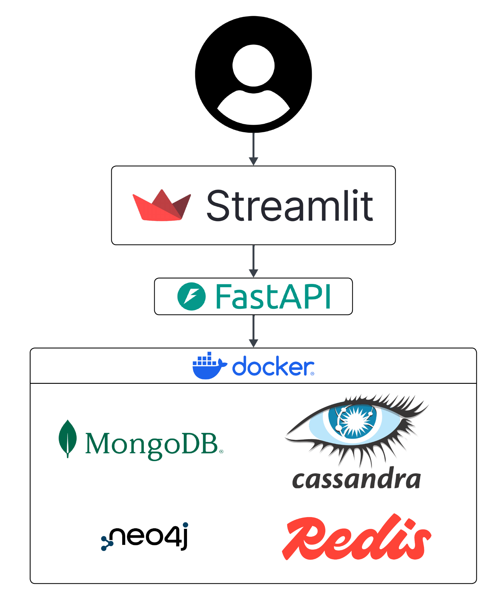
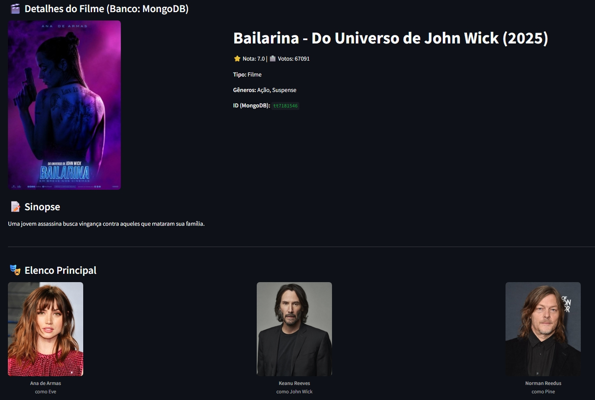
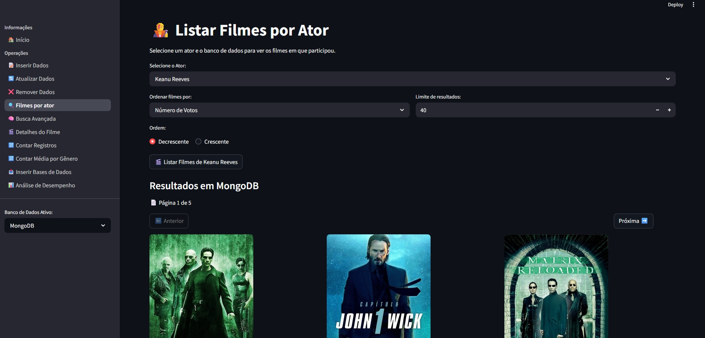
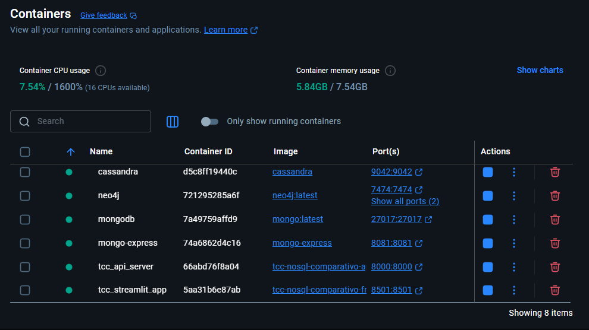
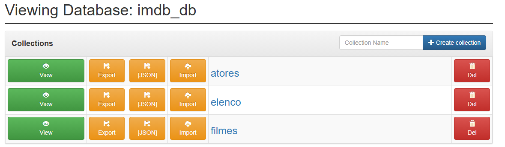
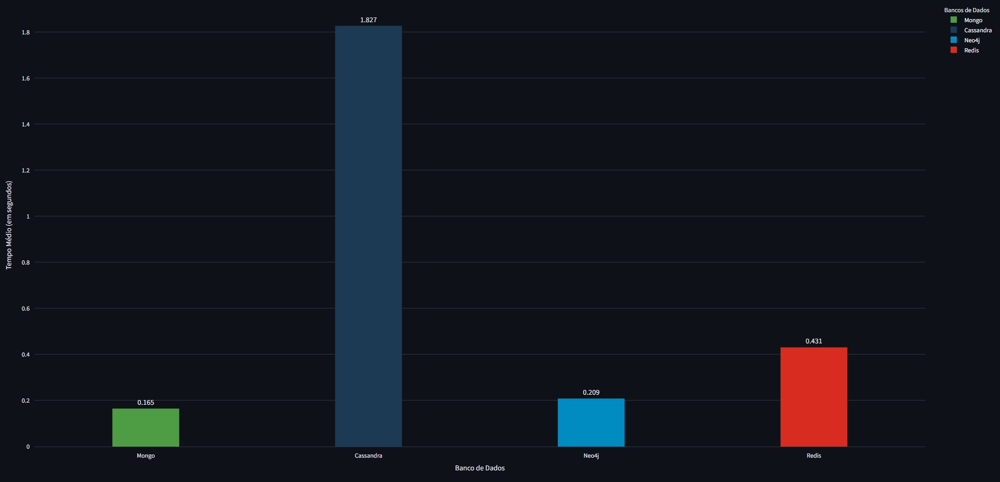

# Análise Comparativa de Bancos de Dados NoSQL

**Aplicabilidade e desempenho de banco de dados NoSQL em aplicações modernas: um estudo de caso em MongoDB, Cassandra, Neo4j e Redis.**

Trabalho de Conclusão de Curso (TCC) desenvolvido para investigar a aplicabilidade e comparar o desempenho de quatro bancos de dados NoSQL em diferentes cenários de operações sobre dados.

O projeto reúne uma aplicação funcional com API REST, interface interativa, integração com quatro bancos de dados e experimentos de desempenho utilizando uma base relacionada a filmes, atores e elenco.

## Visão geral

A aplicação permite interagir com os bancos de dados, executar operações e consultas e visualizar resultados de experimentos comparativos.

Entre os principais componentes estão:

- Implementações de acesso e operações para MongoDB, Cassandra, Neo4j e Redis.
- API REST desenvolvida com FastAPI.
- Interface web interativa desenvolvida com Streamlit.
- Ambiente conteinerizado e orquestrado com Docker Compose.
- Scripts e arquivos de resultados utilizados na análise experimental.
- Dashboard para visualização comparativa das medições.

## Arquitetura



A interface Streamlit é utilizada para interação com a aplicação. As solicitações são encaminhadas à API FastAPI, que se comunica com os serviços dos bancos de dados executados no ambiente Docker.

## Bancos de dados analisados

| Banco de dados | Modelo |
|---|---|
| MongoDB | Orientado a documentos |
| Apache Cassandra | Colunar distribuído |
| Neo4j | Banco de dados de grafos |
| Redis | Estruturas de dados em memória, chave-valor |

## Tecnologias

- **Linguagem:** Python
- **API:** FastAPI
- **Interface:** Streamlit
- **Bancos de dados:** MongoDB, Apache Cassandra, Neo4j e Redis
- **Infraestrutura:** Docker e Docker Compose
- **Bibliotecas de dados e integração:** Pandas e drivers específicos de cada banco

## Funcionalidades

A interface disponibiliza operações e consultas para explorar os dados armazenados nos bancos:

- Inserção de dados.
- Atualização e remoção de registros.
- Busca avançada de filmes.
- Listagem de filmes por ator.
- Exibição de detalhes de filmes.
- Contagem de registros.
- Cálculo de médias por gênero.
- Preparação das bases de dados para os experimentos.
- Análise comparativa de desempenho.

### Detalhes de um filme

A aplicação apresenta informações como pôster, título, avaliação, gêneros, sinopse e elenco.



### Consulta de filmes por ator

É possível selecionar um ator, definir critérios de ordenação e limitar a quantidade de resultados retornados.



## Ambiente de execução

Os serviços são executados em contêineres e orquestrados pelo Docker Compose.



O ambiente também inclui o Mongo Express para visualização e administração das coleções MongoDB.



## Experimentos e resultados

Os experimentos contemplam diferentes operações sobre a base de dados. Os resultados registrados pelo projeto são armazenados em arquivos JSON e utilizados pela interface de análise.

A tabela abaixo apresenta as médias calculadas a partir dos resultados oficiais incluídos no repositório, considerando as execuções de 2 a 10 e desconsiderando a primeira execução, conforme o critério utilizado no dashboard.

| Cenário | MongoDB | Cassandra | Neo4j | Redis |
|---|---:|---:|---:|---:|
| Inserção em lote | 0,1646 s | 1,8265 s | 0,2086 s | 0,4307 s |
| Busca avançada | 0,0497 s | 0,0494 s | 0,0096 s | 0,1163 s |
| Média por gênero | 0,0451 s | 0,0736 s | 0,0096 s | 0,2351 s |
| Busca por ator | 0,0468 s | 0,0622 s | 0,0164 s | 0,0273 s |
| Contagem por ano | 0,0436 s | 0,0692 s | 0,0105 s | 0,2235 s |

*Fonte: arquivos JSON de resultados oficiais do projeto. Médias calculadas com as execuções de 2 a 10. Valores em segundos.*

### Visualização: inserção em lote

O gráfico abaixo apresenta o tempo médio registrado para a operação de inserção em lote nos quatro bancos de dados.



Nos resultados registrados para esse cenário, MongoDB apresentou a menor média, seguido por Neo4j, Redis e Cassandra.

**Nota metodológica:** os valores representam os tempos medidos pela aplicação durante os experimentos realizados. Eles não devem ser interpretados como medições isoladas do processamento interno de cada SGBD nem como uma classificação universal de desempenho. Os resultados dependem da implementação das operações e das condições do ambiente experimental.

## Como executar

### Pré-requisitos

- Docker instalado e em execução.
- Docker Compose disponível.

### 1. Clonar o repositório

```bash
git clone https://github.com/Ozen-ok/tcc-nosql-comparativo.git
cd tcc-nosql-comparativo
```

### 2. Configurar as variáveis de ambiente

Crie o arquivo `.env` a partir do exemplo:

```bash
cp .env.exemplo .env
```

Edite o `.env` e configure as credenciais necessárias conforme as variáveis documentadas no arquivo de exemplo.

### 3. Iniciar os serviços

```bash
COMPOSE_BAKE=true docker-compose up --build
```

Para executar em segundo plano:

```bash
COMPOSE_BAKE=true docker-compose up --build -d
```

### 4. Acessar a aplicação

| Serviço | Endereço local |
|---|---|
| Interface Streamlit | http://localhost:8501 |
| API FastAPI | http://localhost:8000 |
| Documentação Swagger | http://localhost:8000/docs |
| Mongo Express | http://localhost:8081 |

As portas dos bancos de dados também são publicadas pelo ambiente Docker Compose. O ambiente foi estruturado para execução local de desenvolvimento e experimentação; não exponha os serviços diretamente à internet sem configurar autenticação, rede e controles de segurança apropriados.

## Estrutura do projeto

O repositório está organizado em diretórios que separam a API, a lógica de acesso aos bancos, a interface, os dados, os testes e os recursos visuais.

```text
tcc-nosql-comparativo/
├── .streamlit/
├── assets/
│   └── imagens/
├── data/
├── src/
│   ├── api/
│   ├── core/
│   ├── databases/
│   ├── models/
│   ├── services/
│   ├── streamlit_app/
│   └── utils/
├── testes/
├── .env.exemplo
├── .gitignore
├── docker-compose.yml
├── Dockerfile
└── requirements.txt
```

## Autor

**Ozen**

Trabalho de Conclusão de Curso em Engenharia da Computação — Universidade Estadual do Maranhão (UEMA).

[Repositório no GitHub](https://github.com/Ozen-ok/tcc-nosql-comparativo)
